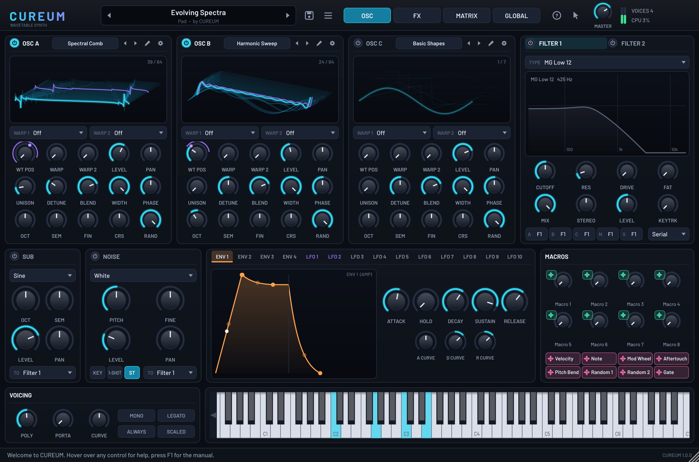

# CUREUM

CUREUM is a wavetable synthesizer plugin (VST3, AU and standalone) in the style of Xfer Records' Serum and Serum 2. It opens Serum presets and banks, can host your own VST3/AU effects inside its FX rack, and has a built-in help system for every control.



## Features

**Sound engine**
- 3 wavetable oscillators with up to 16 unison voices each (detune, blend, width, stack modes), band-limited mip-mapped playback, 2 warp slots per oscillator and 38 warp modes, including cross-oscillator FM, PM, AM and RM.
- Sub oscillator, noise oscillator (one-shot or looping samples, keytracking) and direct/filter routing for every source.
- 2 filters with 101 filter types (analog-style ladders, SVFs, combs, flangers, phasers, formants, EQs, diode and MS-20 style), in serial or parallel.
- 4 envelopes (attack, hold, decay, sustain, release, with curve controls), 10 LFOs with drawable shapes, sample & hold, smooth random and chaos (Lorenz, Rossler) modes, plus 8 macros.
- Drag-and-drop modulation from any source onto any knob. The 64-slot matrix adds aux sources, curves and bipolar or unipolar amounts.
- 32 voices with poly, mono and legato modes, glide, MPE, and 1x/2x/4x oversampling.

**Effects**
- Reorderable rack with Hyper/Dimension, Distortion, Flanger, Phaser, Chorus, Delay, Compressor (incl. multiband), Reverb, EQ, Filter, Frequency shifter, Utility and Convolution.
- **4 plugin slots that load your own VST3 (and AU on macOS) effects** into the rack. They have their own editor windows, and their state is saved with the preset.

**Presets**
- Opens **Serum 2 `.SerumPreset`**, **Serum 1 `.fxp`** and **`.fxb` banks**, plus `.zip`/`.SerumPack` packs and whole folders. A bank can be imported in one go into your user library.
- Preset browser with search, favourites, format badges and your Serum folders listed next to CUREUM's own presets. Ships with 24 factory presets.
- Wavetable import/export (WAV, including Serum's `clm` frame-size marker) and a wavetable editor with drawing, harmonics, formulas and processing tools.

**Interface and help**
- Modern dark interface, resizable from 50% to 200%.
- Help system with a searchable manual (17 topics, press **F1**), hover help in the status bar for every control, and a **What's This?** mode: click the pointer button next to **?** in the header, then click any control to read about it.

## Getting CUREUM

### Download a build

Every push builds CUREUM for Windows, macOS (universal: Apple Silicon + Intel) and Linux with GitHub Actions. Open the [Actions tab](https://github.com/d4v1ma/cureum/actions), pick the latest successful run and download `CUREUM-Windows`, `CUREUM-macOS` or `CUREUM-Linux` from the artifacts.

Copy the plugin to your plugin folder and rescan in your DAW:

| OS | VST3 | AU |
| --- | --- | --- |
| Windows | `C:\Program Files\Common Files\VST3\` | n/a |
| macOS | `~/Library/Audio/Plug-Ins/VST3/` | `~/Library/Audio/Plug-Ins/Components/` |
| Linux | `~/.vst3/` | n/a |

The CI builds are not code-signed. On macOS, remove the download quarantine before first use, for example:

```bash
xattr -dr com.apple.quarantine ~/Library/Audio/Plug-Ins/Components/CUREUM.component ~/Library/Audio/Plug-Ins/VST3/CUREUM.vst3
```

### Build from source

Requirements: CMake 3.22 or newer, a C++20 compiler (Visual Studio 2022, Xcode 15 or newer, GCC 11+ or Clang 15+), and Ninja (optional). JUCE 9.0.6 is downloaded automatically during configuration.

On Linux, install the development packages first (Debian/Ubuntu names):

```bash
sudo apt-get install ninja-build libasound2-dev libfreetype-dev libfontconfig1-dev libx11-dev libxext-dev libxrandr-dev libxinerama-dev libxcursor-dev libxcomposite-dev libxrender-dev libgl1-mesa-dev
```

Configure and build:

```bash
cmake -B build -G Ninja -DCMAKE_BUILD_TYPE=Release
```

```bash
cmake --build build --config Release
```

The plugins end up in `build/Cureum_artefacts/Release/` (`VST3/CUREUM.vst3`, `AU/CUREUM.component` on macOS, `Standalone/`). On Windows use `-G "Visual Studio 17 2022"` instead of Ninja. To build a universal macOS binary, add `-DCMAKE_OSX_ARCHITECTURES="arm64;x86_64"`.

CMake options:

| Option | Default | Meaning |
| --- | --- | --- |
| `CUREUM_JUCE_DIR` | empty | Use a local JUCE checkout instead of downloading it |
| `CUREUM_JUCE_TAG` | `9.0.6` | JUCE version to download |
| `CUREUM_BUILD_TESTS` | `ON` | Build the `CureumTests` tool |
| `CUREUM_ENABLE_LTO` | `OFF` | Link-time optimisation for the plugin |

## Using Serum presets

Open a preset with **Menu > Open preset file...**, double-click it in the browser, or drag `.SerumPreset`, `.fxp` or `.fxb` files onto CUREUM. **Menu > Import bank / pack / folder...** converts a complete library into `User/Imported/<bank name>`.

Serum presets usually refer to Serum's own wavetables and noise samples by name. If you own Serum, add your Serum preset folders on the **GLOBAL** page (CUREUM also tries to find them automatically) so the original tables are used. Otherwise CUREUM substitutes the closest factory table. Wavetables embedded in a preset are always imported.

Imports are a close starting point, not a bit-exact copy. The formats are undocumented and CUREUM's DSP is its own. Serum 2's sample, granular, spectral and multisample oscillators, the arpeggiator and the clip sequencer are not imported. See [the in-app help page](Resources/Help/14-serum-import.md) for the full list.

## Hosting effect plugins

On the **FX** page, choose **+ Add effect** and pick a plugin. First scan your plugin folders on the **GLOBAL** page (**Scan for plugins**), or add a single plugin file. A hosted plugin works like any built-in unit: drag it to reorder, bypass it, set its dry/wet mix, or open its own editor. Its settings are stored inside the CUREUM preset and the DAW project. If a project is opened on a machine where the plugin is missing, the status bar says which plugin could not be loaded.

## Development

`CureumTests` is a command-line tool that is built together with the plugin:

```bash
build/CureumTests_artefacts/Release/CureumTests --unit
```

| Command | What it does |
| --- | --- |
| `--unit` | Unit tests: DSP, importers (with synthetic Serum files), engine, presets |
| `--validate <CUREUM.vst3 or .component>` | Loads the built plugin through a plugin host, as a DAW would, and checks audio at several sample rates and block sizes, parameters, state restore, parameter fuzzing, thread safety and the editor |
| `--import <file>` | Imports a Serum or CUREUM preset and prints what was converted |
| `--render <preset or factory:N> <out.wav>` | Renders a short phrase to a WAV file |
| `--screenshot <out.png> [tab] [scale] [factory:N or file]` | Renders the editor to an image. `tab` is `osc`, `fx`, `matrix`, `global`, `browser`, `help`, `wteditor` or `lfo` |

On Linux without a display, run the tests under `xvfb-run -a`. Set `CUREUM_FIXTURES` to a folder of real Serum presets to also run the fixture-based import tests. Third-party presets are not part of this repository.

The CI workflow (`.github/workflows/build.yml`) builds all formats on the three platforms, then runs the unit tests, `--validate`, [pluginval](https://github.com/Tracktion/pluginval) at strictness level 10 and, on macOS, `auval`.

### Source layout

| Folder | Contents |
| --- | --- |
| `Source/Core` | Parameter registry (IDs, ranges, help text), choices, filter type table |
| `Source/DSP` | Wavetables, oscillators, filters, envelopes, LFOs, modulation matrix, voices, effects, plugin hosting |
| `Source/Presets` | CUREUM preset format, Serum 1/2 readers, CBOR decoder, preset manager, factory bank |
| `Source/UI` | Look and feel, widgets, panels, pages, preset browser, wavetable editor, help system |
| `Source/Plugin` | `AudioProcessor` and editor |
| `Resources/Help` | The manual shown in the help panel (Markdown) |
| `ThirdParty/zstd` | Zstandard decompressor, used for Serum 2 presets |
| `Tests` | `CureumTests` |

## Legal

Serum and Serum 2 are trademarks of Xfer Records. CUREUM is an independent project and is not affiliated with, endorsed by or connected to Xfer Records. CUREUM reads Serum presets for interoperability only and ships none of Serum's presets, wavetables or code. VST is a trademark of Steinberg Media Technologies GmbH.

CUREUM is built with [JUCE](https://juce.com), which is available under the GNU AGPLv3 or a commercial JUCE licence. Distributing CUREUM binaries requires complying with one of them. Bundled third-party components: Barlow fonts (SIL Open Font License 1.1, see `Resources/Fonts/OFL.txt`) and Zstandard (BSD licence, see `ThirdParty/zstd/LICENSE`).
